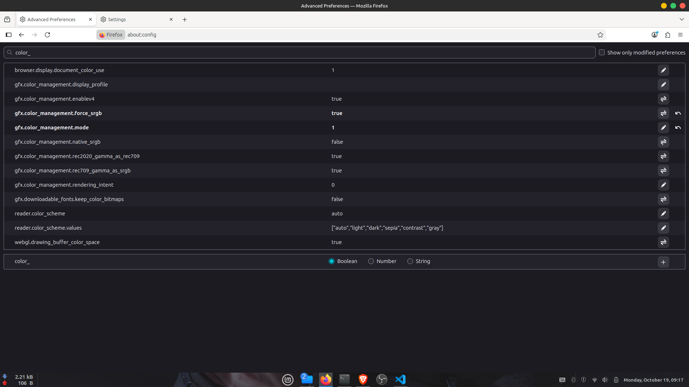

# Color Washed Out

So I've been using my linux from August back then and there's an issue about my brave browser, actually all chromium based browser like firefox has this washed out color that's so saturated, way more saturated than the actual color. So I find the solution but none of them works for me. Until I find the solution myself. So here's what I do. The most easy fix was turning off graphic acceleration, but that means we turn off the WebGL support and many web app that use WebGL won't work properly.

## My Suspicion

There's some suspicion about the reason this problem happened:

1. Graphic driver support mismatch
2. My KDE Plasma desktop environment glitch (I dont even understand what is this but many people talking about this lolz)
3. Color Gamut

## My Solution

It turns out that it was color gamut problem. Here's how I fix it:

1. Go to brave flags by using this URL: `brave://flags`, for chrome and edge you can use their name as well (`chrome://flags`, `edge://flags`). For firefox it was `about:config` then accept the risk.
2. For chromium find `Force color profile` set it to sRGB
3. For firefox follow this settings:

4. Done! See the difference

After searching a while it was actually common problem in other app as well like my vscode here. For vscode the solution is here: [fixing-vscode-color-bug-on-linux](https://dev.to/iamst0rm/fixing-vscode-color-bug-on-linux-185f)
