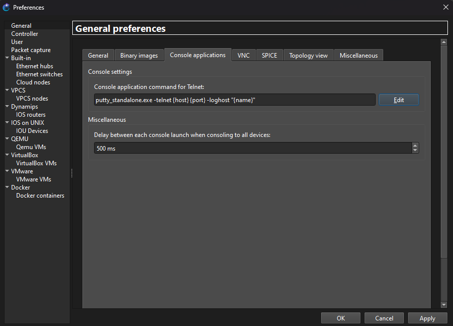
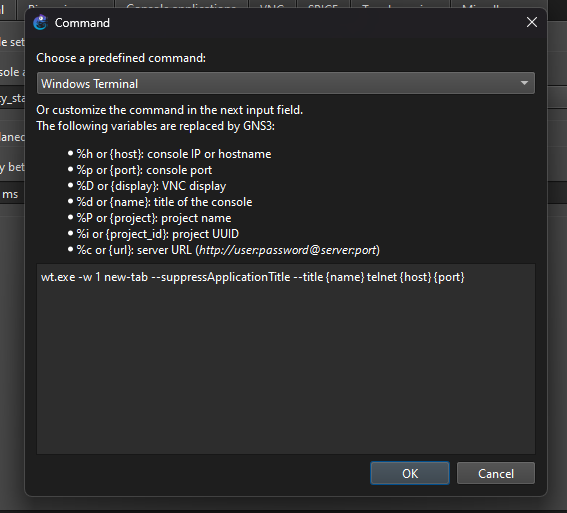
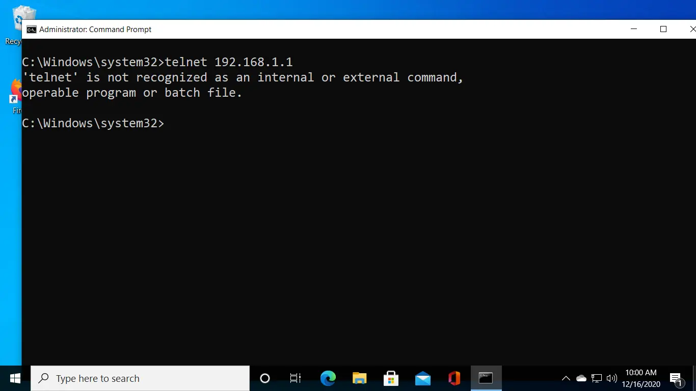
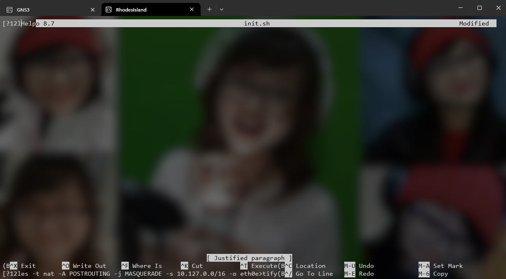
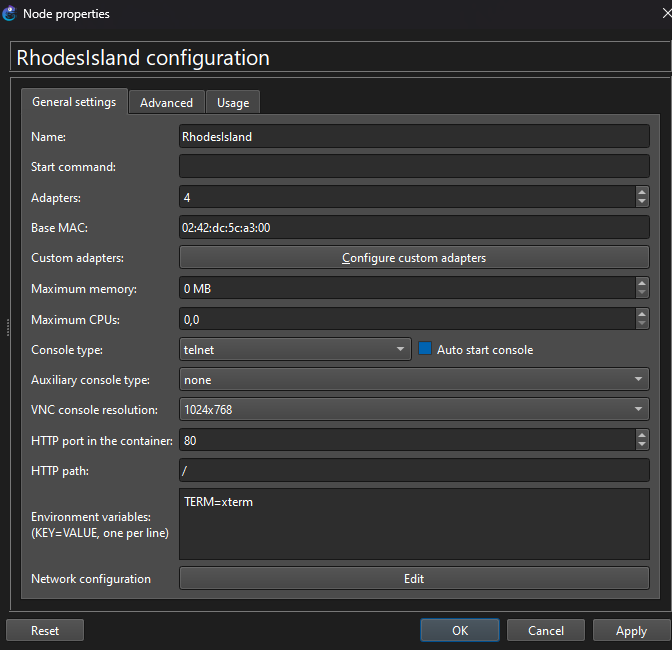
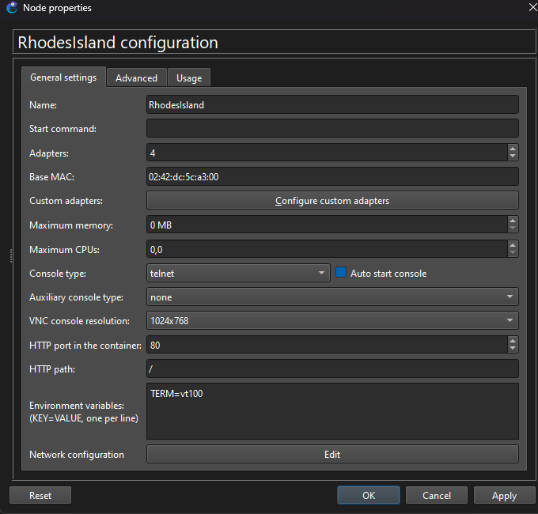

# How To Change Console

In this section, I want to show you how to change default console for telnet in GNS3 from default to Windows Terminal or Powershell.

## Default Console

Default console is probably `PuTTY-Standalone` which is built-in inside GNS3 (idk, i'm not sure, can possibly built-in inside windows). You can check by going into `Edit > Preferences > General > Console Applications` like this:

<div align="center">
  
</div>

## How to Change

Here's step by step to change the console to powershell:

1. In `Edit > Preferences > General > Console Applications` click edit
2. Change from PuTTY to Windows Terminal

<div align="center">
  
</div> <br />

3. Now your terminal probably have no telnet like this:

<div align="center">
  
</div> <br />

You can activate by `opening your windows terminal as administrator` then paste this command:

```ps1
dism /online /Enable-Feature /FeatureName:TelnetClient
```

4. Notice that you can now run the console in your node, but you'll notice that some text is not rendered correctly. For example, here I run nano of my node and it render horrible text:

<div align="center">
  
</div> <br />

From what I know, this happened under 2 possibilities:

1. Node terminal does not interact correctly or node terminal compatibility issue
2. Different text encoding format.

I'm sorry about the number 2 because I didn't find any solution. I'll update this if I found the solution. <br />

So for number 1 reason it can be easily fixed by changing your node env spesifically `TERM=...` to `TERM=vt100`. This is because powershell support vt100. You can do this by running `export TERM=vt100` or like this:

<div align="center">
   <br/>
  <p>From this</p>
   <br/>
  <p>To this</p>
</div> <br />

Actually you can also choose `vt220`. For my device both works the same way. <br/>

Good now your terminal is clean. But please note that some minor compatibility issue still occur.

---

Made with 💖 by Ahmad Fakhrul Bawani.
